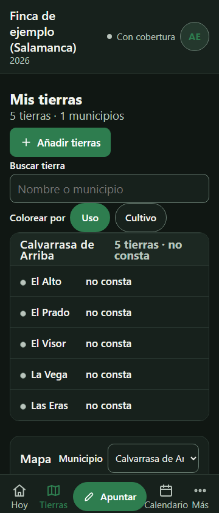
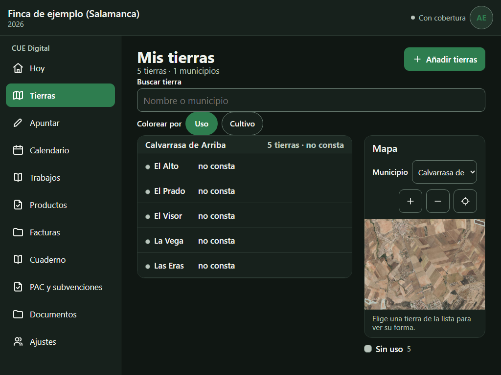
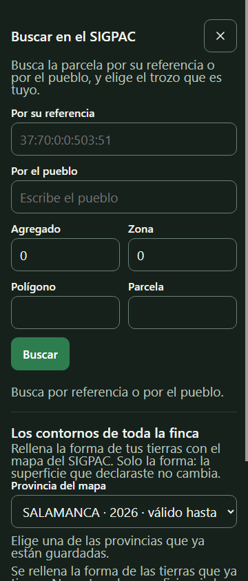
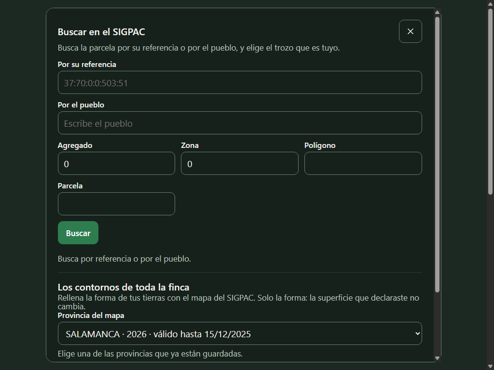
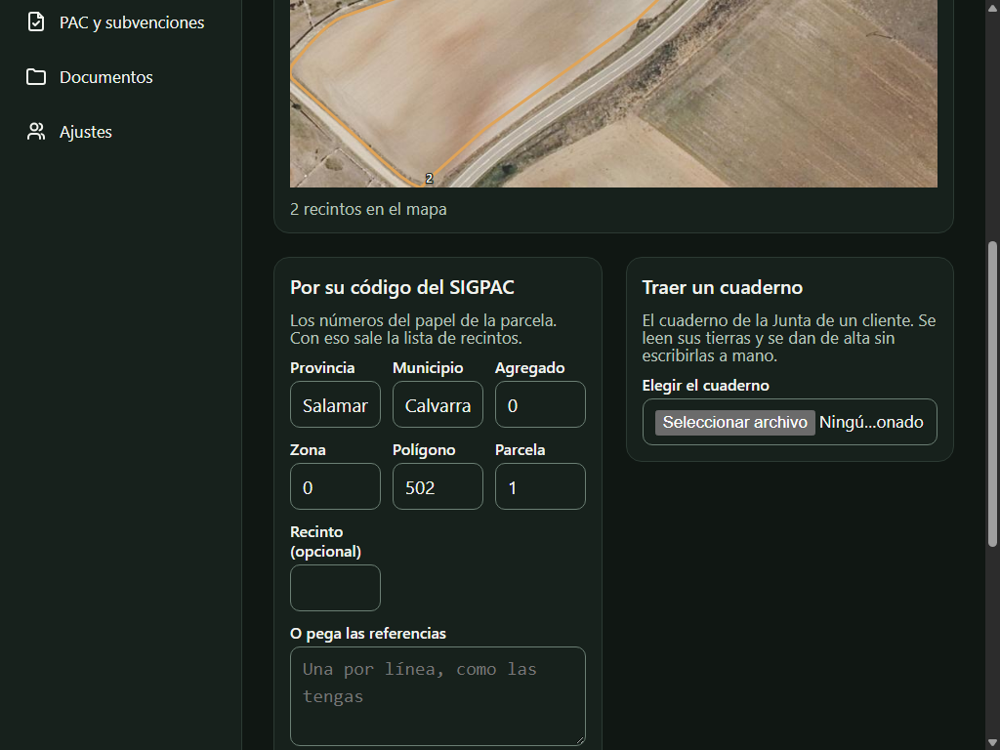
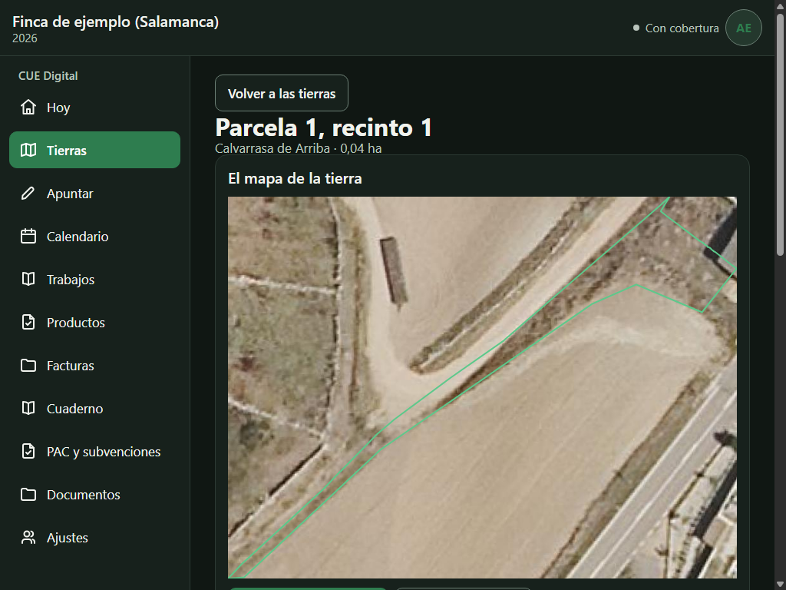

# CUE Digital — cuaderno de campo y gestión de la explotación agraria

**Abre desde cualquier sitio:** <https://servidor.tail4263a0.ts.net:8443> ·
**Demo con los datos dentro (sin servidor):** <https://erdeivih.github.io/cuedigital-demo/> ·
**Estado:** funcional y en desarrollo · **Cuenta de ejemplo:** `demo@cuedigital.local` / `cuaderno-demo-2026`

---

## 1. El problema

El cuaderno de campo de un agricultor vive en papel, en hojas de cálculo y en la cabeza de quien
lo lleva. Cuando llega una inspección —o cuando hay que cuadrar la PAC— hay que reconstruir qué se
hizo, dónde y cuándo, y la información está repartida entre papeles que no se hablan entre sí.

**CUE Digital** reúne en una sola aplicación el cuaderno de campo y la gestión de la explotación
(tierras, trabajos, gastos, maquinaria, contactos), pensada para usarse **de pie en una parcela**,
con el sol de frente, el móvil en una mano y sin cobertura.

## 2. Qué demuestra (y con qué evidencia)

| Competencia | Cómo se ve en el proyecto |
|---|---|
| **Producto completo, no una maqueta** | FastAPI + SQLAlchemy 2 en el servidor; **27 pantallas en React** sin compilar (UMD + htm); PostgreSQL 16 en producción y SQLite en local. La app completa está publicada y se puede probar. |
| **Datos oficiales de verdad** | Las tierras se dan de alta **con su referencia del SIGPAC**: el programa llama al servicio del FEGA y trae superficie, uso, pendiente y **el contorno**. La finca de ejemplo son **cinco parcelas reales de un cliente de Salamanca**, con su forma sacada del GeoPackage del SIGPAC. |
| **Geodatos, no un mapa de adorno** | La forma se guarda como texto WKT (funciona igual en SQLite y en PostgreSQL), el mapa se pide al SIGPAC por recinto y por punto, la app **dibuja el contorno con los datos** cuando no hay ortofoto, y hay caché por provincia: la finca se ve con su forma real aunque el servicio del FEGA no conteste. |
| **Una app de campo, no un formulario** | Se usa **de pie en la parcela**: la lista de tierras se busca y se toca (no se teclea el código), el mapa recibe el toque para elegir el recorte, los campos de números abren **teclado numérico**, los controles miden **44 px o más** y las tablas y los modales caben en un móvil de 360 px. |
| **Calidad medida, no prometida** | **6.116 pruebas de Python y 1.322 de JavaScript**, en verde, con guardianes que impiden que los números de la documentación se queden viejos. |
| **Interfaz para el campo** | Medido con Chrome de verdad a **360, 390, 768 y 1024 px**: **0 desbordes**, **0 controles por debajo de 44 px** y **0 huecos por debajo de 8 px**. Antes de los arreglos eran 30 controles y 135 huecos. |
| **Sin cobertura** | La pantalla va en cola cuando no hay red y la aplicación sigue funcionando; el mapa se dibuja con el contorno guardado cuando no se puede pedir la foto. |
| **Cumplir con la Administración** | Lectura del cuaderno de la Junta (Cuecyl) por las **etiquetas** de sus hojas, no por coordenadas fijas (la plantilla cambió entre 2024 y 2025); cliente del IUWS con los métodos y mensajes del anexo del FEGA; comprobación de la firma del cuaderno y «tres finales»: bien, mal y *no lo he podido comprobar*. |
| **Despliegue de verdad** | Imagen Docker (usuario sin privilegios, HEALTHCHECK), PostgreSQL, Caddy delante, y una URL estable con Tailscale Funnel. La demo estática se publica en GitHub Pages con los datos dentro, para enseñarla sin depender de ningún servidor. |

## 3. Números (10/11/2026)

| Dato | Valor |
|---|---:|
| Pruebas de Python / JavaScript | **6.116 / 1.322** |
| Pantallas en React | 27 |
| Tablas en la base de datos | 67 |
| Parcelas de ejemplo con contorno real | 5 |
| Anchos comprobados (móvil y tableta) | 360, 390, 768, 1024 px |
| Desbordes / controles pequeños / huecos pequeños | **0 / 0 / 0** |

## 4. Cómo se comprueba

```bash
# La app completa, desde cualquier sitio: abrir la URL y entrar con la cuenta de ejemplo.
https://servidor.tail4263a0.ts.net:8443

# En el repositorio:
python deploy/comprobar_publica.py https://servidor.tail4263a0.ts.net:8443      # parcelas y contorno
python deploy/comprobar_alta_publica.py https://servidor.tail4263a0.ts.net:8443  # alta de 6 números y layout
python deploy/comprobar_demo.py https://erdeivih.github.io/cuedigital-demo/ # la demo sin servidor
```

## 5. Prueba visual (capturas de la app publicada, 10/11/2026)

| Móvil (360 px) | Escritorio (1024 px) |
|---|---|
|  |  |
|  |  |
|  |  |

Y la parcela dada de alta con los seis números del papel, con su contorno dibujado:
[`estable-ficha-nueva-390.png`](docs/capturas-despliegue/estable-ficha-nueva-390.png).

| Alta en escritorio (1024 px) | Su ficha, con el contorno |
|---|---|
|  |  |

## 6. Lo que falta (dicho sin adornos)

- El volcado oficial a la Junta (IUWS) está implementado y probado contra el anexo, pero **no se ha
  enviado nada real**: depende de que la Junta dé de alta el acceso.
- El registro de la explotación no está completo: faltan catálogos que la Administración no publica
  y el código de la DGC.
- PSD2 (conciliación bancaria) está parado por presupuesto.
- La URL estable depende del servidor de casa (Tailscale Funnel). Si el equipo se apaga, no
  contesta; la demo de GitHub Pages sigue en pie.

## 7. Tecnologías

Python · FastAPI · SQLAlchemy 2 · PostgreSQL · SQLite · React (UMD, sin compilar) · htm ·
Docker · Caddy · Tailscale Funnel · GitHub Pages · SIGPAC (FEGA) · Cuecyl (Junta de Castilla y León) ·
Tesseract (OCR de facturas) · pdfplumber
